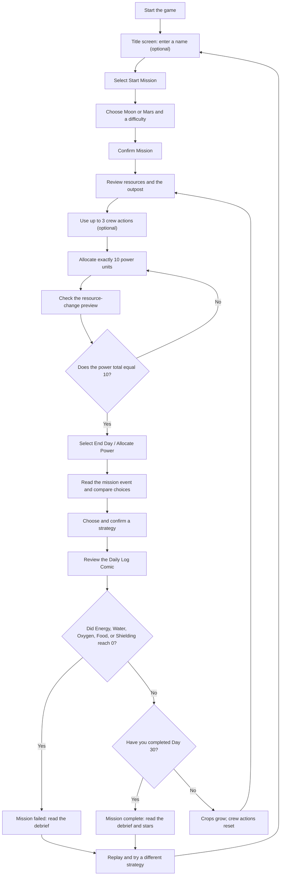

# SOLBOUND: Junior Astronaut Mission Trainer

SOLBOUND is a 30-day resource-management game built with Next.js 16, React 19, TypeScript, Tailwind CSS 4, Framer Motion, and Zustand.

## Run the game

Install dependencies and start the development server:

```bash
npm install
npm run dev
```

Open [http://localhost:3000](http://localhost:3000) in your browser. To create a production build, run `npm run build`.

## How to play



### Setup

1. On the title screen, enter a name if you want it displayed in NOVA's greeting and as the crew lead. You can leave it blank.
2. Select **Start Mission**.
3. Choose the **Moon** or **Mars**, then choose **Easy**, **Normal**, or **Expert** difficulty.
4. Select **Confirm Mission** to begin Day 1. Easy starts with more supplies; Expert starts with fewer.

### Your daily routine

Each day, use the dashboard to check the resource meters and inspect the outpost modules. Click a building to open it. You have **3 crew actions per day**; actions are optional, but can help replenish resources or grow food.

Then manage the **Daily Power Budget**:

1. Adjust the sliders for Habitat, Greenhouse, Power Station, Radiation Shelter, and Research Lab.
2. Assign exactly **10 power units** in total. **Quick Balance** provides a starting split, but it may not suit your current needs.
3. Read **Preview consequences** to see how the allocation will change resources. Increase support for the systems whose resources are low.
4. When the remaining power is **0**, select **End Day / Allocate Power**.
5. Compare the event choices and their resource effects. Pick one that addresses your biggest risk without exhausting another essential resource, then confirm it.
6. Read the Daily Log Comic and select **Continue Mission** to advance to the next day.

The Moon and Mars have different resource pressures, and events can change your meters. Use the preview and current resource levels rather than relying on one fixed allocation or event choice.

### Crew actions and resource solutions

Each action uses one crew action. The greenhouse actions for planting, watering, and harvesting also use one action each.

| If this resource is low | Try this |
| --- | --- |
| **Energy** | Assign more power to the Power Station, or clean the solar panels in its module (**+6 energy**). Battery maintenance gives **+5 energy** for **3 water**; the emergency reserve gives **+8 energy** for **2 shielding**. |
| **Water** | Repair the water recycler in the Habitat (**+6 water** for **4 energy**). Greenhouse research can also trade **3 water** for **4 science**. |
| **Oxygen** | Monitor air quality in the Habitat (**+3 oxygen** for **1 energy**). Prioritize Habitat and Greenhouse power when adjusting the daily allocation. |
| **Food** | Plant a greenhouse bed (**2 water**), water growing beds, and harvest a ready crop (**+10 food**). A planted crop starts watered; water it on following days to help it grow. It takes about three mornings to become ready. A growing crop wilts after two days without water. |
| **Shielding** | Run a shelter drill (**+3 shielding** for **1 energy**), monitor space weather (**+4** for **2 energy**), or add regolith shielding (**+8** for **6 energy**). |
| **Science** | Analyze samples in the Lab (**+5 science** for **4 energy**) or research hydroponics in the Greenhouse (**+4 science** for **3 water**). Science is not required to survive, but it contributes to a top star rating. |

Other useful details:

- You can spend up to 3 crew actions each day. Unused actions do not carry over.
- Watering all thirsty beds is one action; it costs 1 water for each bed watered.
- Module upgrades cost **8 science** and improve that module's daily contribution, up to level 3.
- The resource preview includes your power allocation. Event choices and crew actions can change resources separately.
- Energy, Water, Oxygen, Food, and Shielding must stay above zero. If any reaches zero after a daily decision, the mission ends. Science can be spent down to zero without ending the mission.

### Winning and stars

Complete all **30 days** without letting Energy, Water, Oxygen, Food, or Shielding reach zero to secure the outpost. A failed mission can be replayed; your name and accessibility settings are retained.

The final star rating depends on your ending resources:

- **3 stars:** average of the five survival resources is at least 60, and Science is at least 40.
- **2 stars:** average of the five survival resources is at least 45.
- **1 star:** you complete the mission below those thresholds. A failed mission receives 1 star.

To aim for more stars, protect every survival resource while also earning Science. Before ending each day, check the weakest meter, account for the preview and event costs, and avoid spending heavily on research if life support is at risk.

## Accessibility

Use the title-screen controls to enable **Large text** or **Reduced motion**.

## Deployment

Push the project to GitHub and import it into Vercel to deploy.
