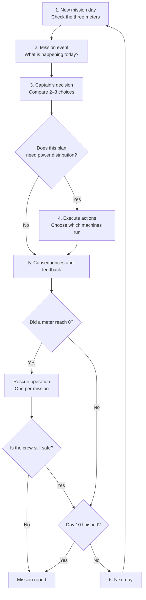

# SOLBOUND: Junior Astronaut Mission Trainer

SOLBOUND is a short mission game for young captains. You run a Moon or Mars outpost for **10 mission days**, keeping three meters alive:

- **Life Support** — air, water and food for the crew
- **Power** — electricity stored in the batteries
- **Protection** — walls and shields against space radiation

The game is built with Next.js 16, React 19, TypeScript, Tailwind CSS 4, Framer Motion and Zustand.

## Run the game

```bash
npm install
npm run dev
```

Open [http://localhost:3000](http://localhost:3000). To make a production build, run `npm run build`.

## Before Day 1: base setup

The title screen and mission setup come first. After the captain confirms a destination and difficulty, a four-step onboarding flow introduces the base:

1. **Welcome** — NOVA greets the captain and previews the starting meters.
2. **Meet the Crew** — Amara (Leadership), Chen (Engineering), Ortiz (Plant Science) and Sami (Research).
3. **Build your base** — drag and drop, or tap, the Habitat, Solar Panels, Oxygen System and Greenhouse onto the green plots. The Habitat must be built first. Each building adds a small starting bonus.
4. **Colony ready** — review the colony, the mission goal and the boosted starting meters, then select **Begin Day**.

| Building | Starting bonus |
| --- | --- |
| Habitat | Life Support +4 |
| Solar Panels | Power +6 |
| Oxygen System | Life Support +3 |
| Greenhouse | Life Support +2, Protection +2 |

The bonuses keep the 10-day economy intact: they reward the setup step without removing the trade-offs in the daily loop.

## Comic book flipbooks

The **Comic Book** button appears on the title screen, the mission setup screen, the first base-setup page, and in the mission top bar. It opens an interactive Heyzine flipbook inside a popup:

- **Moon mission:** lunar edition
- **Mars mission:** Martian edition

The popup closes with the X button, the Escape key, or a click on the dark background. If the embedded viewer is blocked by the browser, use **Open in new tab** in the popup header.

## The gameplay loop

Every day follows the same six steps:



### 1. New mission day

The day screen shows all three meters, the crew's mood, a reminder of yesterday's decision, and any space-weather watch. Select **Start Today's Briefing** when you are ready.

### 2. Mission event

NOVA explains what is happening. Each event lists **What could happen?** before you decide. Real NASA DONKI space-weather events can replace the hand-written event when the live API is available.

### 3. Captain's decision

Every event offers two or three strategies. Every strategy shows:

- its **advantage** (green), and
- its **disadvantage** (amber).

There is no perfect choice. Compare the costs with your weakest meter, then confirm.

### 4. Execute actions (only when relevant)

Some choices ask for a **power plan**. You can switch the Greenhouse, Research Lab and Extra Lights on or off. The **Oxygen System is always on**, because the crew must breathe. The screen previews the next day's meters before you confirm.

Power plans last for one day. Each new morning starts from the safe default so an old plan cannot quietly weaken the base.

### 5. Consequences and feedback

After the day resolves you see:

- the before/after value of all three meters,
- a breakdown of every change (decision, machines, solar array, daily needs, planet conditions),
- **NOVA's lesson**, and
- **What did you learn?**, one idea to remember.

### 6. Next day and rescue

If a meter reaches **0**, the crew gets **one rescue operation per mission**. Each rescue option shows its cost, and an option is disabled if it would empty another meter. If the base cannot be kept alive after the rescue, the mission ends and the report explains why.

Choices leave memory tags, so later events can follow up on what you did (for example, rationing water can bring the recycler back).

## Daily economy

Each day starts with:

| Change | Amount |
| --- | --- |
| Crew needs | Life Support −10, Protection −5 |
| Solar array | Power +6 (Mars dust days and Moon nights reduce it) |
| Oxygen System (locked on) | Power −4, Life Support +6 |
| Greenhouse | Power −2, Life Support +2 |
| Research Lab | Power −3, Protection +4 |
| Extra Lights | Power −1, Life Support +1 |

- **Mars:** power is slightly lower each day; dust storms reduce solar output.
- **Moon:** the long lunar night starts on day 6 and cuts solar power while the base gets colder.

All meters are simplified game values, not real mission measurements.

## Winning and stars

Finish all **10 days** with every meter above zero to secure the outpost.

- **3 stars:** every meter ends at **55 or higher**, and you never needed a rescue.
- **2 stars:** every meter ends at **30 or higher**.
- **1 star:** you finish below those thresholds, or the mission ends early.

Replays keep your name, base name and accessibility settings.

## Real data

- **DONKI space weather** (`/api/space-weather`) is fetched live when possible. Real flares and coronal mass ejections can become that day's event and are labelled **Live** in the event card.
- If the live call fails, the game uses the saved event pool and the hand-written stories. Those facts are labelled **Archived**.
- The Science Library explains the real science words used in the game.

Set `NASA_API_KEY` in `.env.local` to raise the DONKI request limit. Without it the app uses NASA's `DEMO_KEY`.

## Accessibility

The title screen and settings panel include **Large text** and **Reduced motion**. Sound effects and background music can be toggled separately, and the preference is remembered in the browser.

## Project layout

- `lib/game/constants.ts` — meter names, starting supplies, daily drain, systems
- `lib/game/types.ts` — all game types
- `lib/game/engine.ts` — daily resolution, rescue options, stars, event choice
- `lib/game/events.ts` — 12 hand-written events and their follow-ups
- `lib/game/spaceWeather.ts` — DONKI normalization and live event override
- `lib/game/store.ts` — the Zustand state machine for the loop
- `components/game/*Screen.tsx` — one component per stage of the loop, plus the four-step `SetupScreen` onboarding flow

## Deployment

Push the project to GitHub and import it into Vercel. No database is required.
